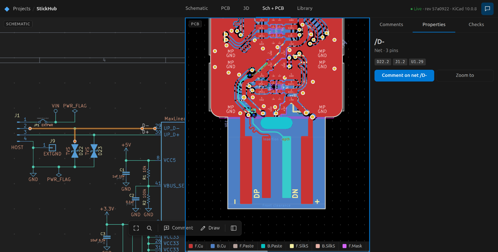
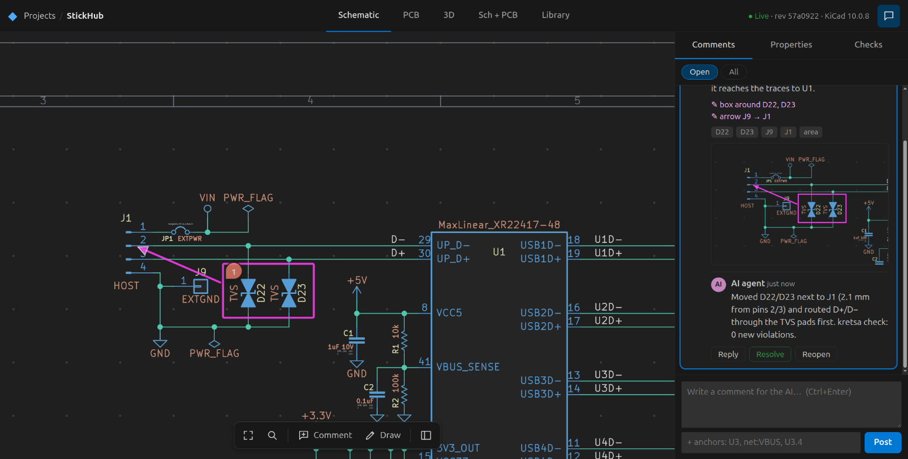
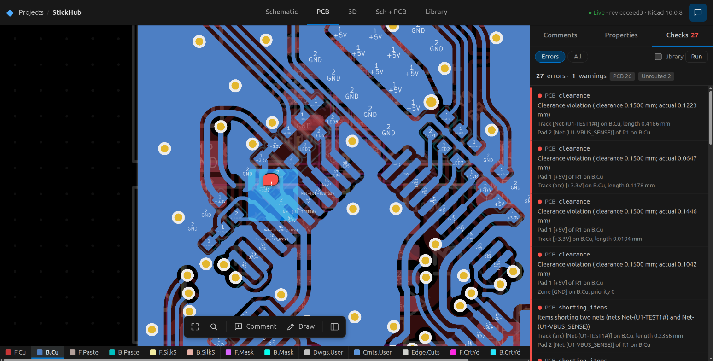
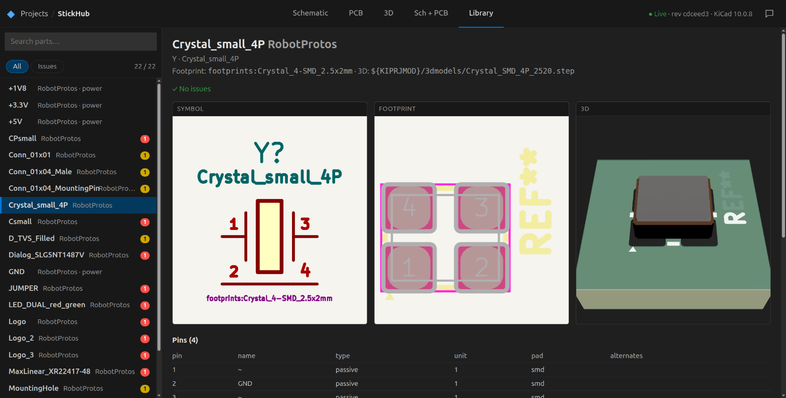
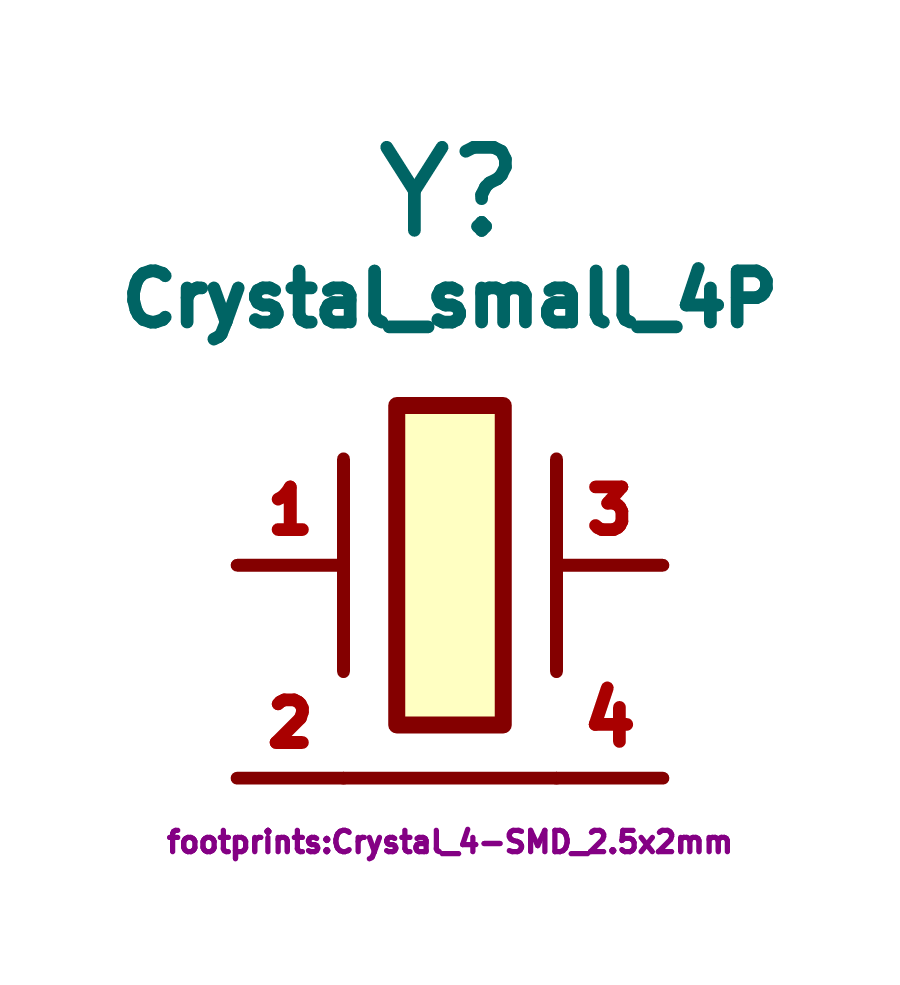
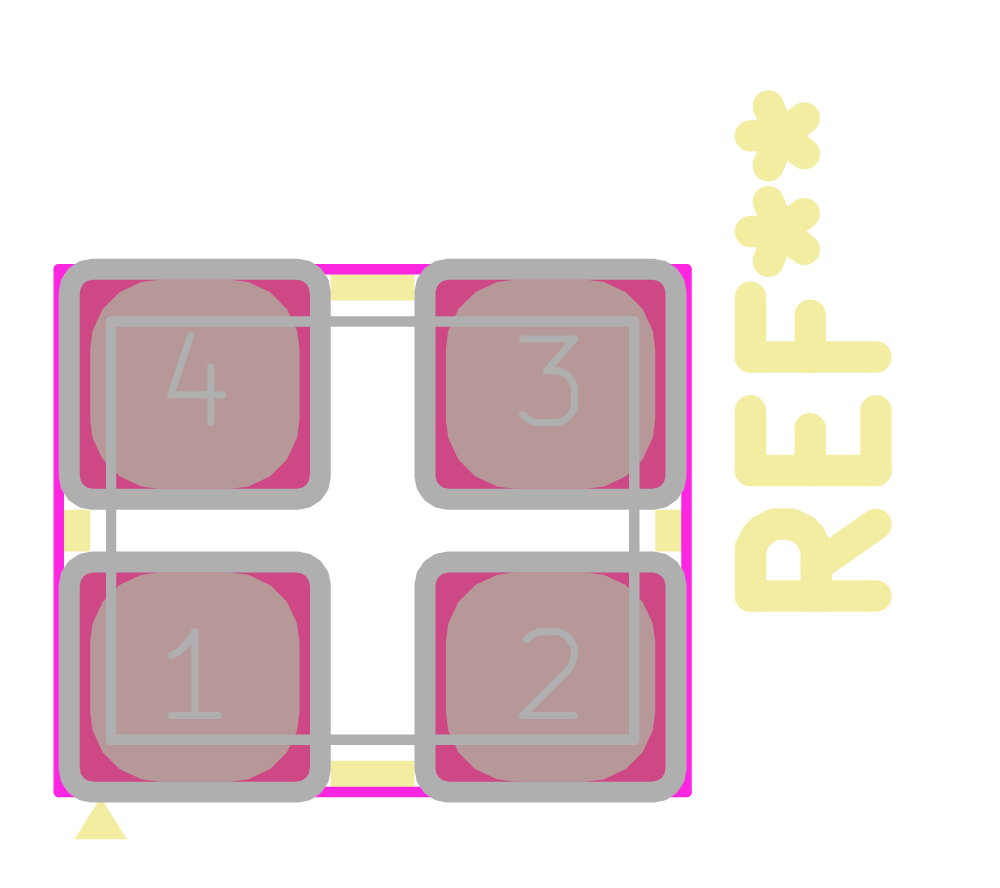
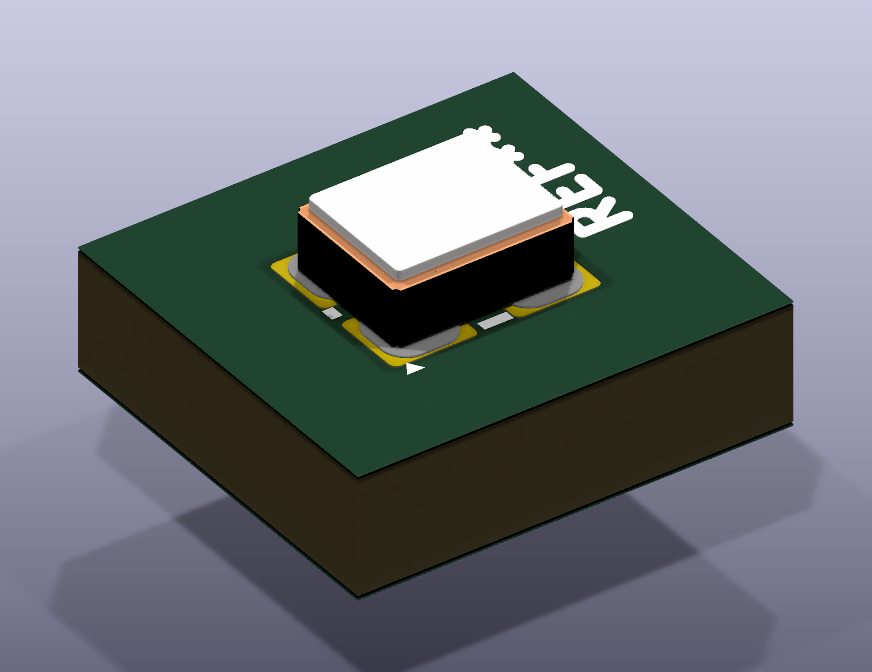
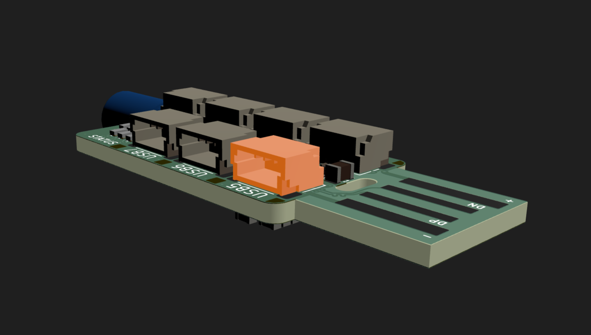
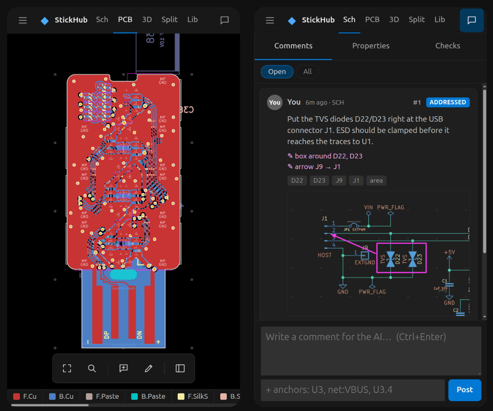

# kretsa

**Review KiCad designs with your AI agent: point, draw, comment, and let it close the loop.**

kretsa (Swedish *krets*, "circuit", turned into a verb: *to circuit*) is a local, web-based viewer for KiCad
schematics, PCBs and 3D models, built for the moment when an AI agent is designing the board. The agent edits the KiCad files.
You watch the design update live in your browser, select parts and nets, scribble on the schematic, and leave comments. The agent
reads those comments as structured data plus screenshots, makes the change, checks its own work, and replies.



```
 ┌────────────┐  edits .kicad_sch/.kicad_pcb   ┌──────────────┐  live reload   ┌───────────┐
 │  AI agent  │ ─────────────────────────────▶ │  KiCad files │ ─────────────▶ │  browser  │
 │ (any CLI)  │                                └──────────────┘                │  (you)    │
 │            │ ◀── .kretsa/review.json ◀──── comments, drawings, snapshots ◀──│           │
 └────────────┘      kretsa review / check / lib show                          └───────────┘
```

## What you get

### Point at things, draw on them, talk to the agent

Click a part, a net, a track or a copper pour. Drop a pin, or draw boxes, arrows and freehand marks on the schematic or PCB.
Each comment is stored in **KiCad document coordinates**, so it stays attached when you zoom, and it carries what you meant
in machine-readable form. The agent gets more than "a box at (169, 41)": it reads *box around D22, D23; arrow from J9 to J1*,
together with a cropped screenshot with your drawing burned in.



What the agent reads (`.kretsa/REVIEW.md`, generated alongside `review.json`):

```markdown
## c_mw9u2qzczrc1 · sch · StickHub.kicad_sch · **addressed**

Anchors: D22, D23, J9, J1, area [153.38, 38.35, 186.26, 51.60] mm

Put the TVS diodes D22/D23 right at the USB connector J1. ESD should be clamped before it reaches the traces to U1.

Drawing (document mm):
- rectangle [169.3, 41.5, 186.3, 51.6] mm around D22, D23
- arrow from J9 to J1 (153.4, 38.4) mm

Snapshot: .kretsa/snap/c_mw9u2qzczrc1.png

> **ai**: Moved D22/D23 next to J1 (2.1 mm from pins 2/3) and routed D+/D− through the TVS pads first. kretsa check: 0 new violations.
```

### Cross-probing that understands nets

One selection is shared by every view. Select U1 in the schematic and the PCB zooms to it while the 3D model tints it. Click
a wire, a label, a track, a via or a zone fill, and the whole net lights up everywhere: the schematic switches sheet if it has
to, the PCB highlights the copper, and 3D tints every part on the net. Schematic and PCB nets are matched through their pins
(`U3.4`), so differences in net names don't break it.

### ERC + DRC that the agent can act on

`kretsa check` runs KiCad's ERC on the schematic and DRC with schematic parity on the board, filters out the noise, and
shows **what is new or fixed since the agent's previous check**. That makes it easy to verify an edit:

```markdown
# Design check · rev cdceed33c4291e29

ERC: ran · DRC: ran · **27 errors, 1 warnings**

## Since last check (rev 57a0922e475e73a8): 28 new, 0 fixed

- **error** `clearance` Clearance violation (clearance 0.1500 mm; actual 0.0647 mm) — Pad 1 [+5V] of R1 on B.Cu
  @ (146.652, 94.677); Track (arc) [+3.3V] on B.Cu, length 0.1178 mm @ (146.712, 94.222)  ← NEW
- **error** `unconnected_items` Missing connection between items — Track [+5V] on B.Cu @ (145.452, 94.677);
  Pad 1 [+5V] of R1 on B.Cu @ (146.652, 94.677)  ← NEW
…
```

The viewer has the same list. Click a violation to jump to it, with the sheet switched, the camera zoomed and the spot marked.



### A library browser, for you and the agent

In a kretsa workflow **the agent authors every part**, so kretsa shows only the libraries your project registers in its
`sym-lib-table` / `fp-lib-table` and never falls back to KiCad's stock libraries. Each part is checked as a unit: the footprint
resolves, every symbol pin has a pad, a courtyard exists, and a 3D model is present and not a stock path.



`kretsa lib show <part>` gives the agent the same information as text (fields, pin table matched against pads, pad table,
model transform) plus renders to look at:

| symbol | footprint | 3D |
|---|---|---|
|  |  |  |

### 3D, projects, and your phone

The board in 3D comes from `kicad-cli pcb export glb`, and clicking a part selects it everywhere. A workspace can hold many
projects. You and the agent share a *current project*: when the agent runs `kretsa use other-board`, your browser follows.
On a phone, the panels become drawers so you can review from the couch.

| | |
|---|---|
|  |  |

## Quick start

Requirements: [Bun](https://bun.sh) ≥ 1.1, **KiCad 10** (9 untested) with `kicad-cli` on your `PATH` (or set `KICAD_CLI`), and Node/npm
to build the vendored KiCanvas once. 2D works without kicad-cli. 3D, checks, netlists and part renders need it.

```sh
git clone --recursive https://github.com/<you>/kretsa && cd kretsa
bun install
bun run build:kicanvas      # one-time: builds the vendored KiCanvas renderer
bun link                    # puts `kretsa` on your PATH (or use: bun cli/src/main.ts …)

kretsa serve ~/my-boards    # a folder with one or many KiCad projects
# → http://localhost:7777 (also on your LAN: http://<your-ip>:7777)
```

## Hooking up your agent

kretsa works with any agent that can run shell commands (Claude Code, Codex, Aider, …). Run the agent in your project or workspace
folder and add something like this to its `CLAUDE.md` / `AGENTS.md`:

```markdown
## Design review (kretsa)
- The human reviews this design in kretsa. Run `kretsa review` to read open comments (anchors, drawings,
  snapshot paths: look at the PNGs). Handle each one, then set it to "addressed" with a short reply
  in `.kretsa/review.json` (rules: docs/review-format.md in the kretsa repo). Never set "resolved".
- Run `kretsa check` before and after every change. Don't leave NEW violations behind.
- Make every part yourself in the project libraries. Inspect each one with `kretsa lib show <part>` and
  look at the renders before using it.
- Switching boards? `kretsa use <project>`, and the human's viewer follows.
```

Your own conventions (field sets, KLC deviations, fab rules) also belong in that file. kretsa itself stays generic.

## CLI

| Command | What it does |
|---|---|
| `kretsa serve [dir]` | Web viewer for a workspace or project folder (`--port`, `--host`, `--dev`) |
| `kretsa projects` / `kretsa use <project>` | List projects / switch the shared current project |
| `kretsa review` | Open review comments as markdown (`--json` for raw `review.json`) |
| `kretsa check` | ERC + DRC + schematic parity, with new/fixed since the last run (`--json`, `--fail`) |
| `kretsa status` | Files, revision, comment counts, last check |
| `kretsa lib [query]` | Parts in the project's libraries, with health checks (`--issues`) |
| `kretsa lib show <part>` | One part in full, plus symbol / footprint / 3D renders (`--no-3d`) |
| `kretsa lib fp <Lib:Name>` | One footprint, including ones no symbol uses |

Output is markdown by default, which suits LLMs, and JSON with `--json`. Everything works on the files directly, so the viewer
doesn't need to be running.

## How it works

- **Read-only toward KiCad files.** kretsa never writes `.kicad_sch` / `.kicad_pcb`; only the agent (or you, in KiCad) does.
  Its only output is review data in `<project>/.kretsa/`: `review.json` (the contract), `REVIEW.md`, `snap/*.png`, `ink/*.svg`,
  plus caches (`cache/`, `check/`, `parts/`). Commit `review.json` if you want the review history in git, and ignore the rest.
- **2D** is rendered in the browser by [KiCanvas](https://github.com/theacodes/kicanvas) (vendored), driven through its internals
  for picking, net highlighting and camera control. **3D** uses `kicad-cli pcb export glb` + three.js.
- **Checks, netlists and renders** come from `kicad-cli`, cached by file hash. The server watches the project and pushes reloads over
  WebSocket.
- Code layout: `core/` (all logic), `cli/` (the `kretsa` command), `server/` (HTTP/WebSocket for the UI), `web/` (vanilla TS
  frontend), `shared/` (types, including the review contract). See [CLAUDE.md](CLAUDE.md) for the details.

> **Security:** the server listens on all interfaces and has **no authentication**. Use it on networks you trust, or pass
> `--host 127.0.0.1`.

## Status

Early stage. Tested with KiCad 10.0.8 on Linux. KiCad 9 should work but is untested. Known gaps: no diff overlay yet ("what changed since this comment"),
libraries outside the project folder aren't watched live, and there are no KLC style checks for parts yet.

## Credits

- [KiCanvas](https://github.com/theacodes/kicanvas) by Alethea Katherine Flowers (MIT): the 2D renderer that makes this possible.
- [three.js](https://threejs.org), [resvg](https://github.com/RazrFalcon/resvg), and KiCad's `kicad-cli`.
- Screenshots show **StickHub** by Stefan Hamminga ([rbts.co](https://rbts.co), CC BY-NC-SA 4.0), included in `fixtures/` with
  KiCad's `pic_programmer` demo. The review comment and the board defects in the screenshots were staged for the demo.

## License

[MIT](LICENSE). Third-party parts keep their own licenses: `vendor/kicanvas` (MIT), `fixtures/stickhub` (CC BY-NC-SA 4.0,
see its `LICENSE.md`), and `fixtures/pic_programmer` (from KiCad's demo projects).
